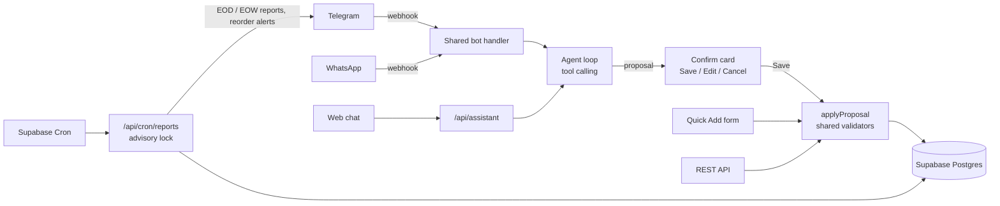

# AI Shopkeeper

**A chat-first retail system: inventory, sales and profit for one shop with many staff.**

## What it is

I built AI Shopkeeper for my cousin's small B2B shop. Staff and the owner talk to an AI agent over Telegram, WhatsApp or the web. A cashier types "2 coke, 1 bread", confirms the card, and the stock goes down and the profit is booked. The owner also gets a web dashboard, scheduled end-of-day and end-of-week reports, reorder alerts, projections, PDF invoices and payroll.

## Demo

Demo video coming soon. There is no public live link; the app runs for one shop.

## How it works

- One Next.js 16 (App Router) app is both frontend and backend. Route handlers are thin; all server logic lives in `lib/`.
- The agent is a stateless tool-calling loop, and it runs the same way for web, Telegram and WhatsApp.
- Messaging is webhooks only, because the app is serverless on Vercel and there is no long-lived process to poll.
- Scheduled reports run from one protected tick endpoint behind a Postgres advisory lock, so two ticks never double-send.
- Invoice and receipt PDFs and product images go to a private Supabase Storage bucket.

## Things I'm proud of

**The model never writes to the database.** Write tools only propose. The proposal shows up as a Save / Edit / Cancel card, and the DB changes only when a person presses Save. At most one write proposal is allowed per turn.

**Confirm-card state lives in Postgres.** A serverless webhook has no memory between requests, so pending cards are stored in a `bot_pending` table keyed by shop, provider and chat.

**Three ways in, one set of validators.** A chat proposal, the Quick Add form and a REST call all go through the same parse functions and the same apply step, so the accepted shapes can't drift apart.

**Cashiers can't see cost or profit.** Roles are owner, manager, cashier and staff, and cost and profit are hidden from staff at three separate layers, not just in the UI.

**The shop is the tenant.** Every query is keyed on `shop_id`, because one shop has many staff. Money is stored as integer cents everywhere: in the database, in `lib/`, in request bodies and in tool arguments.

By the numbers: 306 commits, more than 1,800 tests, around 25 tables, over 20 agent tools for the owner and a handful for a cashier.

## Stack

| Layer | Tech |
|---|---|
| App | Next.js 16 (App Router), React 19, TypeScript, Tailwind CSS 4 |
| Data | Supabase Postgres via `pg`, Supabase Storage, Supabase Auth (`@supabase/ssr`) |
| AI | Tool-calling agent over an OpenAI-compatible chat completions endpoint, separate vision endpoint |
| Channels | Telegram and WhatsApp webhooks, web chat |
| Documents | PDFKit invoices, QR codes |
| Jobs | Supabase Cron |
| Hosting | Vercel |
| Tests | `node:test` with `tsx` |

## Screenshots

<!-- screenshots: add assets/screenshot-1.png ... -->
Screenshots coming soon.

## How I built it

I built this with Claude Code. I direct it, and I review and test what it writes. AI Shopkeeper started as a port of the patterns from my earlier project, AI Accountant, into a new domain, and the repo is explicit about where the two differ.

Every commit has to pass four checks: `tsc --noEmit`, `next build`, lint and the test suite. The typecheck is separate on purpose, because the Next build does not typecheck the tests folder, and that gap caught broken test fixtures three times. Verification in this repo is automated only, with database logic covered by unit tests.

## Code access

The source is private. I'm happy to walk through the code in an interview.

- LinkedIn: https://www.linkedin.com/in/mdadel034
- Email: bombusbumblebees002@gmail.com
